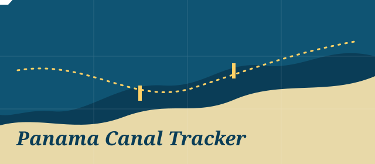
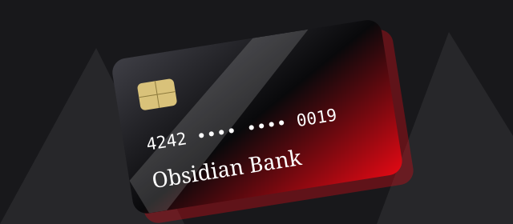
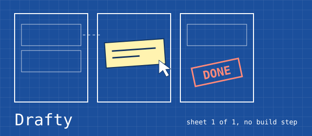
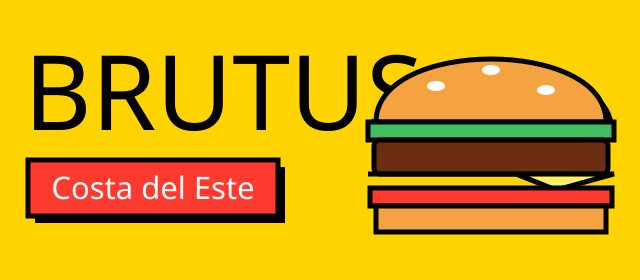
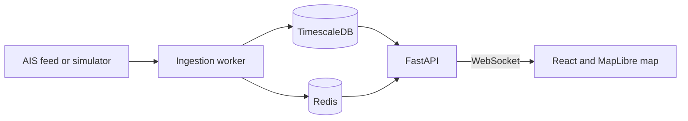

Full-stack developer based in Panama, open to on-site and remote roles.

[Email](mailto:samirherrera15@gmail.com) · [LinkedIn](https://www.linkedin.com/in/samirlorenzo)

## Selected work

<table>
<tr>
<td width="50%" valign="middle">

</td>
<td width="50%" valign="middle">
<h3>Panama Canal Tracker</h3>

<em>In development</em>

Tracks vessels around the Panama Canal from live AIS data.

<ul>
<li>Worker ingests AIS messages and writes them in batches to TimescaleDB</li>
<li>Redis and WebSocket push updates to a MapLibre map</li>
<li>Argon2id, JWT and rate limiting protect the API</li>
<li>Python typed with mypy; design decisions recorded as ADRs</li>
</ul>

<a href="https://github.com/zSamir015/panama-canal-tracker">Code</a> · <a href="https://github.com/zSamir015/panama-canal-tracker/blob/main/docs/ARCHITECTURE.md">Architecture</a> · <a href="https://github.com/zSamir015/panama-canal-tracker/blob/main/docs/API_DESIGN.md">API</a> · <a href="https://github.com/zSamir015/panama-canal-tracker/tree/main/docs/adr">Decisions</a>

</td>
</tr>
<tr>
<td width="50%" valign="middle">

</td>
<td width="50%" valign="middle">
<h3>Obsidian Bank</h3>

<em>Live</em>

Online banking demo anyone can try without signing up.

<ul>
<li>Balances change only after server-side validation</li>
<li>Row Level Security limits each user to their own data</li>
<li>Transfers, budgets, card freezing and web push alerts</li>
<li>English and Spanish, installable as a PWA, tested with Playwright</li>
</ul>

<a href="https://zsamir015.github.io/obsidian-bank/">Live demo</a> · <a href="https://github.com/zSamir015/obsidian-bank">Code</a> · <a href="https://github.com/zSamir015/obsidian-bank/blob/main/docs/USER_GUIDE.md">User guide</a>

</td>
</tr>
<tr>
<td width="50%" valign="middle">

</td>
<td width="50%" valign="middle">
<h3>Drafty</h3>

<em>Live</em>

Kanban board styled like a technical drawing, with no framework or build step.

<ul>
<li>Drag and drop built on pointer events, not the HTML5 drag API</li>
<li>Board re-renders by reconciling keyed nodes</li>
<li>One state function handles history, saving and redraws</li>
<li>Works offline and with the keyboard</li>
</ul>

<a href="https://zsamir015.github.io/drafty/">Live demo</a> · <a href="https://github.com/zSamir015/drafty">Code</a>

</td>
</tr>
<tr>
<td width="50%" valign="middle">

</td>
<td width="50%" valign="middle">
<h3>Brutus</h3>

<em>Live</em>

Landing page for a fictional burger joint in Costa del Este.

<ul>
<li>Plain HTML, CSS and JavaScript modules</li>
<li>Supabase Edge Function validates and rate-limits signups</li>
<li>Filterable menu and live opening hours</li>
<li>Tests and Lighthouse checks run in CI</li>
</ul>

<a href="https://zsamir015.github.io/brutus/">Live demo</a> · <a href="https://github.com/zSamir015/brutus">Code</a>

</td>
</tr>
</table>

Panama Canal Tracker architecture

## Stack

<picture>
  <source media="(prefers-color-scheme: dark)" srcset="https://skillicons.dev/icons?i=ts%2Cjs%2Cpython%2Cswift%2Cjava%2Ccs%2Ccpp%2Creact%2Cfastapi%2Csupabase%2Cpostgres%2Credis%2Cdocker%2Cgithubactions&theme=dark">
  <source media="(prefers-color-scheme: light)" srcset="https://skillicons.dev/icons?i=ts%2Cjs%2Cpython%2Cswift%2Cjava%2Ccs%2Ccpp%2Creact%2Cfastapi%2Csupabase%2Cpostgres%2Credis%2Cdocker%2Cgithubactions&theme=light">
  
</picture>
